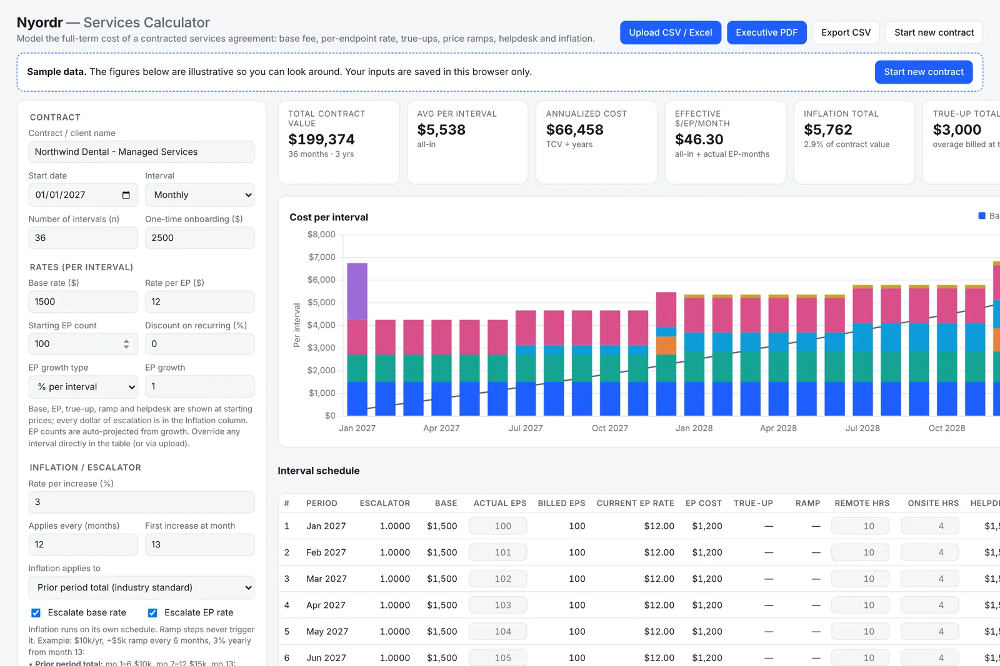
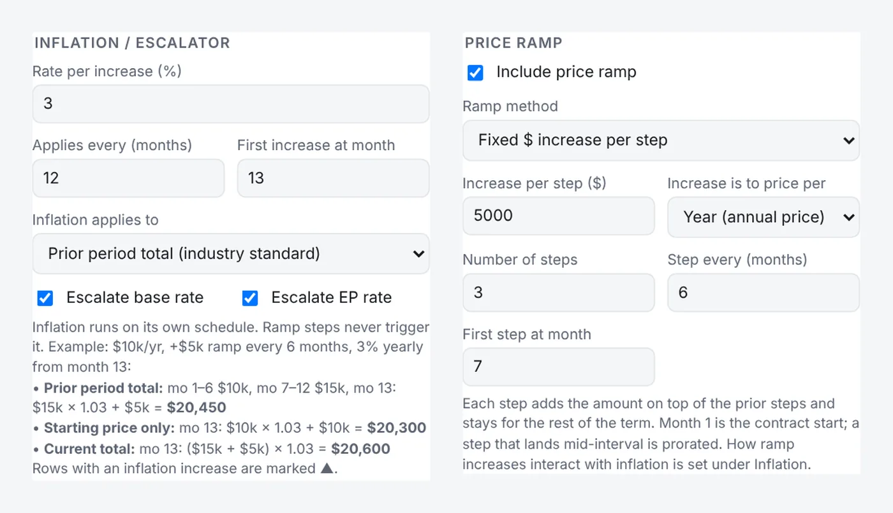
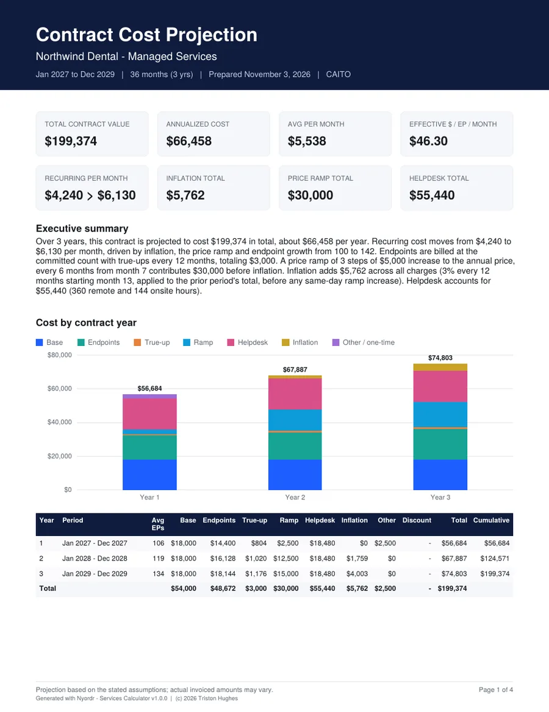
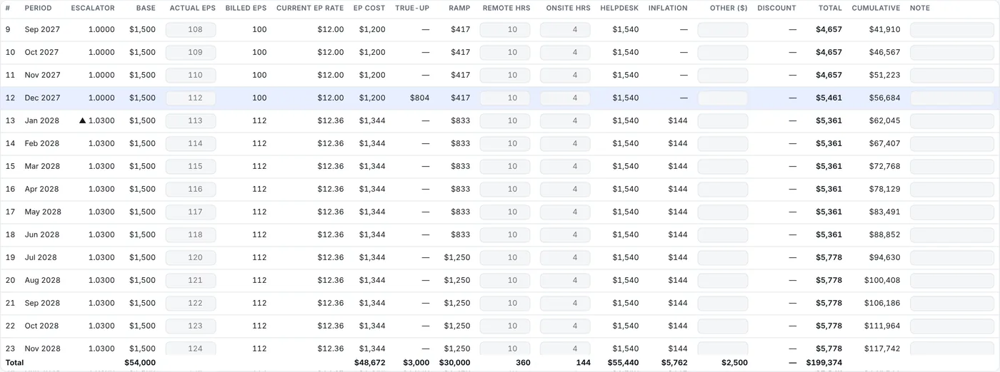

# Nyordr — Services Calculator

**Model what a contracted services agreement really costs across its whole term, then hand decision makers a one-page executive PDF.**

Nyordr is a single HTML file. It needs no installation, no server and no internet connection. Open it in any modern browser, enter a contract's terms (or upload them), and see the cost of every interval, every contract year and the full term: base fees, per-endpoint (EP) charges, true-ups, price ramps, helpdesk hours, one-time costs and inflation, each as its own line.

### ▶ [Launch Nyordr in your browser](https://caitous.github.io/Nyordr-ServicesCalculator/) &nbsp;·&nbsp; ⬇ [Download the latest release](https://github.com/CAITOUS/Nyordr-ServicesCalculator/releases/latest)

No sign-up and no install. It opens on clearly labeled **sample data** so you can look around right away. Click **Start new contract** to clear the sample prices and enter a real one. Your inputs are saved in your own browser only.



---

## What it does

- **Contract term.** Start date, monthly, quarterly or annual intervals, any number of intervals, and one-time onboarding.
- **Rates.** Base rate and rate per endpoint per interval, starting EP count with growth as % or a fixed count per interval, and a discount on recurring charges.
- **True-ups.** Bill the committed EP count and true up overage every *n* months, with an optional premium and admin fee, a reset of the commitment to actual, and optional true-downs (credits). Or bill actual EPs every interval.
- **Price ramps.** Step increases on a schedule, such as *+$5k three times over 18 months*. Steps are a fixed dollar amount (to the monthly or annual price) or a percentage of the base, base + EP, or all recurring charges, compounding or not. A step that lands mid-interval is prorated.
- **Helpdesk.** Remote and onsite hours and rates per month or per year, onsite visits with a trip fee, yearly hours growth, and per-interval hour overrides.
- **Inflation, explained.** Inflation runs on its own schedule (every 12 months from month 13 by default). Ramp steps never trigger it. Choose what it applies to:
  - **Prior period total** (industry standard): inflate what was being paid, then add a same-day ramp step.
  - **Starting price only:** ramp increases are never inflated.
  - **Current total:** add a same-day ramp step, then inflate.
- **Inflation as its own charge.** Every category is shown at starting prices and every dollar of escalation goes in an **Inflation** column, so you can see exactly what inflation costs over the term.
- **Upload or type.** Enter everything by hand, override any interval's EPs, hours or other costs in the table, or upload a CSV or Excel file with a **Schedule** table, a **Settings** table, or both.
- **Executive PDF.** Summary figures, a plain-English executive summary, a cost-by-year chart, the year-by-year breakdown, key assumptions and, optionally, the full interval schedule.
- **CSV export** of the full interval schedule.

| | |
|---|---|
|  |  |
|  | |

---

## Quick start

1. **Open Nyordr**, either way:
   - **In your browser:** [caitous.github.io/Nyordr-ServicesCalculator](https://caitous.github.io/Nyordr-ServicesCalculator/). Nothing to download.
   - **Offline copy:** download `Nyordr.html` (app only) or `nyordr-<version>.zip` (app, guides, license) from [Releases](https://github.com/CAITOUS/Nyordr-ServicesCalculator/releases/latest), then open `Nyordr.html`.
2. **Click Start new contract.** This clears the sample prices and quantities and keeps sensible defaults for the term, inflation and true-up rules.
3. **Enter the contract name, term and rates**, or upload a Settings / Schedule file (templates are in the app under **Upload format**).
4. **Turn on a price ramp or helpdesk** if the contract has them, and set how inflation applies.
5. **Override any interval** in the table where the real numbers differ from the projection.
6. **Export** the executive PDF for decision makers and the CSV for your records.

## Upload format

CSV or Excel. An Excel file can hold both tables as separate sheets.

- **Schedule** (per interval): `interval, endpoints, remote_hours, onsite_hours, other_cost, note`
- **Settings** (any field): `setting, value`, for example `base_rate, 1500`, `inflation_method, prior`, `ramp_method, %`

The full list of setting names is shown in the app under **Upload format → Settings template**.

---

## How accurate is it?

Nyordr gives planning projections, not quotes or invoices. It applies the terms you enter exactly as described above. Real contracts can differ in how they prorate, round, time true-ups or define the inflation base, so check the assumptions page of the PDF against the contract's actual wording before relying on the figures.

---

## Repository contents

```
Nyordr.html            The app (single file, all libraries embedded, works offline)
index.html             Opens Nyordr.html when the site is visited (GitHub Pages)
.nojekyll              Serve files as-is on GitHub Pages
nyordr.json            Version file that copies of Nyordr check for updates
src/Nyordr.src.html    Source of the app, before libraries are embedded
tools/build.mjs        Builds Nyordr.html from the source (npm install && npm run build)
package.json           Pinned versions of the embedded libraries (with package-lock.json)
.github/workflows/     Release workflow: builds the download package for each new version
docs/RELEASING.md      How to publish a new version
docs/images/           Screenshots used in this README
CHANGELOG.md           Version history
LICENSE.md             License terms
```

## Requirements

- Any current browser: Chrome, Edge, Brave, Firefox or Safari.
- **Fully offline.** Charts, Excel import and PDF export are built into the file. Nothing loads from the internet.
- **Nothing is sent anywhere.** Uploads are read on your own device, and inputs are saved in your browser's local storage only. The only network request is an optional check for a newer version (see [docs/RELEASING.md](docs/RELEASING.md)).
- Host it anywhere: open it from disk, put it on a file share, or upload `Nyordr.html` to any web server. If you embed it in an `<iframe>`, add `allow-downloads` to the sandbox so PDF and CSV exports can save.

---

## License

© 2026 Triston Hughes. All rights reserved. Free for personal, educational and internal organizational use. Not for resale, sublicensing or distribution by value-added resellers. See [LICENSE.md](LICENSE.md).

Built by **Triston Hughes** · [LinkedIn](https://www.linkedin.com/in/triston-hughes-949420242/) · [Portfolio Toolbox](https://triston-hughes.vercel.app/)
